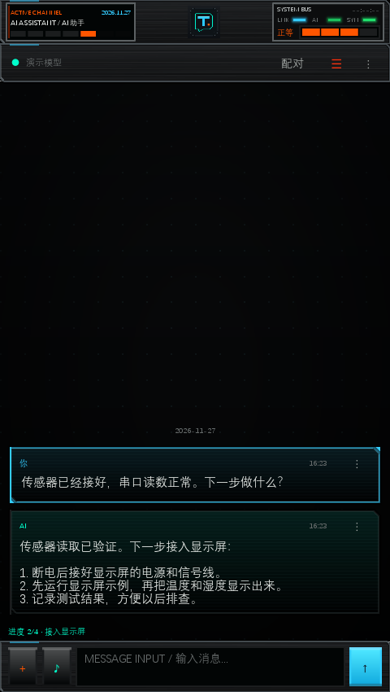
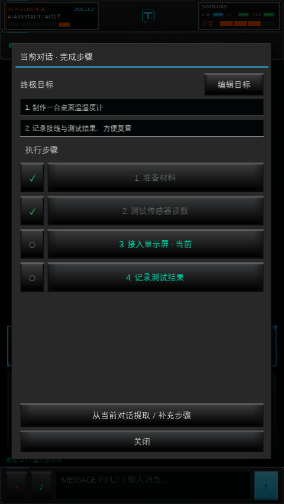

# TalkApp 1.0.0 · 三个臭皮匠

**Three Cobblers · 一个长期助手，按需请其他模型会诊。**

基于 Python/Kivy 的个人安卓 AI 聊天应用，采用黑钛仪器风格。支持文字、图片、文件与按住语音输入，长期会话记忆、目标步骤进度，以及 AI 实际操作应用的工具接口。

日常默认一个主模型，遇到重要问题时手动请另一模型复核；也保留多模型独立建议、交叉评审与最终整合。更多模型不保证更好的答案，复核应关注证据和具体漏洞。

## 下载与使用

**[下载 Android 1.0.0 安装包](https://github.com/SkavenMiqi/three-cobblers/releases/download/v1.0.0/talkapp-1.0.0-arm64-v8a-debug.apk)** · [发行说明](https://github.com/SkavenMiqi/three-cobblers/releases/tag/v1.0.0) · [基础操作指南](docs/quick-start.md)

- **安装**：支持 Android 8.0 及以上、ARM64。此 APK 为调试签名版，可直接安装。首次安装后使用自己的模型服务商 API Key；APK 不含作者的密钥或聊天记录。
- **配置模型**：进入「⋮ → 设置与数据 → 模型接口与外观」，填写服务商 API 地址、API Key 和模型 ID，保存后即可聊天。
- **日常使用**：用输入栏「＋」添加图片或文件；拖动右上角滑杆调整回复篇幅；点底部「进度」查看终极目标和执行步骤。模型支持工具调用时，可以直接在聊天里要求添加步骤、勾选完成、排序或折叠。
- **电脑协作（可选）**：手机首页点「Harness」查看首次连接说明。普通聊天无需电脑，已有配对在局域网内重连。

| 对话首页 | 项目进度 |
| --- | --- |
|  |  |

从源码运行：安装 `requirements.txt` 后执行 `python main.py`，推荐 Python 3.10 或 3.12。安卓构建见 [打包说明](docs/apk-build.md)。

下文为开发阶段记录；当前入口以[基础操作指南](docs/quick-start.md)为准。

## 局域网设备配对（试验版）

两端接入同一局域网，在电脑打开「配对 → 显示配对二维码」，在 Android 10 及以上手机点「配对 → 拍摄配对二维码」，识别后点「配对电脑」确认。也可复制一次性配对串并在手机粘贴。配对码有效期 5 分钟，不要公开分享；无需 ADB、开发者选项或云服务。

主界面历史记录按钮左边的「配对」可直接打开局域网设备配对。已配对的两端都点「开启双向聊天同步」即可开始。功能开启后可关闭配对窗口，在两端继续聊天。手机前台约每 3 秒尝试同步，断线后重试，退到后台暂停，回到前台继续。可在两端各自打开「启动时自动同步」（默认关闭），下次打开 App 时会尝试启动同步。手动停止同步或解除配对会关闭本机的自动同步设置。

首次同步会合并两端普通聊天历史，不覆盖任何一端。消息和图片按批次同步，双方同时续写会保留各自分支。删除、已有对话的改名、临时对话、API Key、设置、项目数据、音频原件及文档附件不同步；在更新前曾手动复制到两个数据库里的旧对话不会自动去重。

同一条已同步对话的目标、执行步骤、完成勾选和当前进行项也会双向同步。同名步骤只合并一份，首次合并保留任一端已有的完成勾选；之后勾选或取消勾选均可同步。点击某一步进入详情，可确认「删除步骤（仅本机）」；另一端保留，重新同步或 AI 提取不会自动恢复本机删除的同名步骤。改标题按新步骤处理，旧条目不会从另一端自动删除。项目资料库不在同步范围内。

已完成步骤默认不折叠。在聊天中发送「把已完成步骤折叠成一条」，由 AI 生成一条可展开的摘要。也可发送「压缩上下文」；上下文估算达到 200,000 tokens 时会自动压缩旧对话（模型窗口或工作预算较小时会提前压缩），并尝试概括尚未折叠的已完成步骤。对话原文和步骤均保留；步骤摘要保存在本机，之后勾选的新步骤不会立即并入。

误删时，在删除的一端点「局域网设备配对 → 找回本机已删对话」。两端都需更新并开启同步；会查询本机已记录的删除项，另一端仍有副本的对话可找回，双方都删除则无法通过同步恢复。

若 Windows 提示防火墙，允许 TalkApp/Python 通过专用网络；如使用了 VPN 或多个网卡，确认填写的是电脑实际的局域网 IPv4。如电脑 IP 改变，需两端解除后重新配对。配对串不要公开发送。

## 项目维护

### 电脑版 OpenCode 桥接

在电脑版打开要共享的普通对话，进入「⋮ → 设置与数据 → OpenCode 本机桥接 → 允许 OpenCode 访问当前对话」。OpenCode 通过本机 `tools/talkapp_mcp.py`（MCP stdio）连接；换工程目录也可使用。App 退出后需重新开启。桥接只监听 `127.0.0.1`，不使用 Android 无线调试。

`read_current_chat` 读取当前分支最近 12 条消息的文本、目标和步骤，不传图片、附件数据、临时对话或接口密钥。`append_work_note` 只追加工程笔记，不自动调用模型；如果当前分支已切换或有新消息，需要先重新读取。两端开启双向聊天同步时，笔记会像普通回答一样同步到手机。「本机桥接」仅指通信路径；OpenCode 调用的模型服务仍可能收到工具返回的聊天文本。

电脑版也可在普通聊天里发「让 OpenCode 看一下这个方案」或「请 Claude Code 给个建议」。支持工具调用的主模型会根据本轮意图决定是否转发，只发送本次输入的文字，不附带旧消息或附件。两个助手都只返回建议，不开放命令、工程修改或烧录。Claude Code 需要支持 `--bare` 的 Windows 版本，并在启动 TalkApp 前设置 `ANTHROPIC_API_KEY`；这个入口不读取 Claude Code 的登录凭据。

### OpenCode 通用执行（Windows / OpenCode V2）

「电脑已接单」「OpenCode 执行中」会作为进度提示同步回原对话，不代表产物已经保存。说「重试上一任务」，或在原请求的消息菜单选择「重跑此 OpenCode 任务」，会用原始要求从原分支新建一次执行；对话里有多个候选时先选任务，不让 OpenCode 猜。系统进度、授权提示和其他 OpenCode 回复不作为新任务的参考资料。

电脑版没有独立的「通用执行」开关。手机发起需两端更新、开启双向同步，并各在「配对 → 自动委派 OpenCode」开启（默认关闭）。两端都可以在普通对话中发送自然语言任务；手机可用「＋ → 语音转文字」或键盘语音输入，原来的长按录音不触发。模型只根据本轮文字判断是否派单，不需要说 OpenCode 的名字，也不用在电脑逐条确认。分类失败回到普通聊天。

任务使用 OpenCode V2 本机服务的独立 `build` 会话，沿用它的模型和工具权限。提交本轮文字及原分支最近最多 8 条已完成消息的节选，不附带图片、附件或 API 密钥。OpenCode 请求额外工具权限时，TalkApp 会显示具体操作；在该提示后说或输入「好」或「拒绝」即可，也可回复包含编号的「批准本次」或「拒绝本次」。仅对匹配的单次请求生效，其他回复或未回复不会自动批准。未获授权、服务不可用或 5 分钟内未返回结果时，会报告实际状态和可用会话 ID，不会自动重发。旧版待处理请求不会被提升成执行任务。

目前不接受外部代码贡献。公开仓库只能由作者或授权协作者写入，但GitHub无法禁止公开Fork或本地修改。
本仓库未采用授予自由修改与再分发权利的开源许可证；原创部分权利保留，第三方部分按原许可。见 `CONTRIBUTING.md`、`THIRD_PARTY_NOTICES.md`。

以下为开发阶段功能记录；准确边界见 `docs/delivery-status.md`。

## 当前长期记忆：增量事实库＋会话回溯

不再在发送消息前重复压缩所有会话。启动后、每次成功回答后及运行中每2分钟检查未处理的普通会话用户消息，每批最多4条；完成过回答且位于选中分支的消息才参与。每条成功处理一次，空数组视为无需记忆，格式错误/网络失败留待重试。旧会话逐批补录，应用关闭不会后台唤醒。
按用户画像user、长期事实fact、项目事项project提取语义key及内容；同key使用最新用户消息为准，明确纠正可更新，forget记录可抑制旧属性。相同正文去重。个人资料跨会话，项目事项按项目隔离；全体普通会话可做关键词历史检索。新对话步骤仍保持独立。
保留消息来源，删除来源会话级联移除事实；如果删除的是纠正记录，较早来源中仍存在的事实可能重新出现。废弃分支事实不参与，切回分支可恢复。没有向量数据库，语义key归并准确度依赖提取模型，不能保证所有同义事实/冲突都识别正确。
新请求按相关度、用户偏好和时序选择精简记忆，默认字符预算最多3500并受模型窗口限制。记忆隐藏自动运行，不弹确认框；后台提取计入memory用量，可用单独的便宜后台模型。不是完整Hermes引擎，但采用增量持久事实与按需会话回溯两层结构。

## 最新：步骤按对话隔离

目标、步骤、当前进行项和PST现在属于当前对话，新建对话从空步骤开始；项目仅共享资料库，不再自动共享进度。旧项目步骤迁移回原来源对话，缺少来源记录时归入该项目最早对话，不复制给全部会话。AI工具只能读取/修改当前对话步骤，撤销也仅影响该对话。

## 当前默认：单模型为主，按需复核

首次升级会将旧的全量多模型协作关闭，保留成员、接口和MiMo语音解析角色。日常每条消息不再自动发给所有成员。
回答菜单“请另一模型复核”选择一个模型，仅额外调用一次，结果独立保存，可免费重看；不自动再调用主模型整合，不执行软件工具。关闭复核窗口可停止等待，已发出的请求仍可能计费。
完整多模型会诊仍可在模型面板手动重新开启，界面明确提示每条额外多次调用。记忆、标题、步骤和摘要按原方案继续运行，没有关闭。

## 多模态成员解析语音

模型切换面板中，“听”指定音频解析模型（例如实际支持音频的MiMo配置）。按住说话后，录音只发给此模型，解析得到的内容再交给主模型/协作成员讨论；其他成员不收到原始音频。主模型仍负责最终文字回答和软件工具操作，不做语音输出。
解析结果按消息缓存，后续追问不重复识别旧录音；用量单列audio_parse。支持在单模型模式使用指定解析成员。协作模式有录音却没有指定“听”时明确提示，不向所有文字模型乱发音频。具体MiMo模型/路由仍须实际支持input_audio，当前实现仅完成模拟验证。

## 当前语音输入（按 Fitness 原版交互）

底部音符按钮长按0.3秒开始录音，松开直接发送录音给当前模型，回答仅显示文字。Android使用原版MediaRecorder AAC/M4A配置和M4A品牌兼容处理；Windows录制WAV。没有自动停句、没有语音输出、不依赖本地Whisper服务。短按提示按住说话。
录音作为音频消息保存在当前分支，后续可重试；删除消息同时删除音频。接口必须支持input_audio，当前4Router若仍返回Audio input is not available会明确报错，不自动转文字。
连续语音和朗读代码保留备用，但不从主界面进入。相应旧说明不代表当前交互。

## 打包前实用增强

- 消息菜单“引用并提问”，无需手动复制整段回答。
- 工作台增加“查找本对话”和“常用提示词”，支持跨分支定位和自定义提示词保存。
- 未发送文字按会话自动保存草稿，切回会话和重启可恢复；不保存尚未发送的附件草稿。
- 每次模型请求（含后续工具轮次）检查完整消息及工具定义的近似token，并预留输出和10%估算余量；请求显式设置max_completion_tokens。
- 上下文预算设置新增模型窗口上限和输出预留。默认模型窗口字段272000仅为可配置值，不代表已验证服务商上限；默认工作预算仍16000，输出预留2048。仍需以实际模型/路由文档为准。
- 支持 400K 的模型可在「上下文 / 摘要」选择「填入 400K」，然后保存预算。该预设同时设置应用预算和模型窗口，仍预留输出及估算余量，不会改变服务商实际限制。
- 工具结果过大时会停止该轮并提示，已执行操作不会自动回滚或重复执行。

参考：Chatbox的消息引用/提示词库、NextChat的模板与上下文管理；为本项目独立实现，未移植其代码。

## 紧凑工作台与多模型协作

顶部移除新建对话+、独立模型切换和齿轮，点击模型名称进入“单模型/多模型协作”；历史侧栏仍提供新建对话，更多菜单按项目/设置分组并可滚动。
模型面板勾选最多3个已保存配置作为讨论成员，点击模型主体设为最终主模型；可手填同服务商模型并保存，再加入成员。
协作流程：各成员独立建议→可选一轮交叉评审→主模型整合并执行软件工具。成员不可操作应用，防止重复修改；结果不是正确性保证。
回答菜单可查看多模型讨论，token分别记录为collaboration_proposal/review及最终chat。N个成员开启评审时，通常额外2N次调用，再加主模型整合/工具轮次。默认单模型，不自动启用付费协作。
参与模型会收到当前请求相关背景和近期最多8条消息，可能包含记忆/资料；选择跨服务商成员意味着这些内容会发给所选服务商。失败成员记录错误，全部失败停止，不暗中当作成功共识。

## 项目与执行闭环

顶部更多菜单新增“项目与共享进度”“项目资料库”“上下文与模型能力”。同项目新对话共享目标、PST步骤和资料；原有会话升级时各自迁入独立项目。
AI实际操作后显示折叠卡片，可查看结果；目标/步骤/标题修改可在没有后续冲突时撤销。资料库同名更新版本，AI可按ID读取，回答可定位引用文件并在原文内搜索。能力档案区分未知、手动标记和工具实际成功；不把多模态宣传当成接口验证。
具体范围及限制见 `docs/projects-and-actions.md`。

## AI实际操作软件

主聊天已接入OpenAI兼容工具调用：读取进度、保存目标、添加步骤、修改步骤/完成状态/当前进行项、改当前对话标题、检索历史和查询应用状态。用户可直接要求“把当前内容加入步骤”“这一步完成了”。操作落库后返回真实结果，PST同步更新；不依赖后台提取代替用户明确指令。
工具链最多6轮，调用消耗记录为聊天用量；模型/服务商需支持工具调用。未注册的能力不开放，不能理解为AI可以控制所有系统程序或读取密钥。删除/覆盖历史尚未开放给工具。当前回归验证使用模拟模型，真实4Router工具兼容性需实际接口验证。

## 对话进度模块

左下角“进度”与右上角PST分段条打开同一个步骤面板。检测到需求类消息并成功回答后，AI后台提取执行步骤；也可手动从当前对话补提取。每步可查看说明、勾选完成，点击“提醒我进行这一步”会把下一步问题放进输入框，确认后发送。
步骤和完成状态按对话持久保存、随加密备份恢复，重复提取不覆盖既有完成状态。提取任务使用后台模型（未配则主模型），计入 `progress` 用量。已有旧对话首次使用可点面板内的提取按钮。

## 最新整批交付

完整状态以 `docs/delivery-status.md` 为准，下面保留的阶段说明可能描述旧版入口。

- 顶部 `⋮ → 备份与恢复`：自动口令加密、本地保留轮换、可选WebDAV上传、加密文件恢复。
- 顶部 `⋮ → 临时对话`：不使用或写入长期笔记、不进备份，离开后清除。
- 顶部 `⋮ → 导出当前对话`：复制或保存当前分支Markdown。
- 输入栏 `+`：最多4张图片、安卓拍照、PDF/Word/文本附件；已发图片可放大查看。
- 发送照片时，视觉模型可在同一次回答中按需附上自动标注图。应用在副本上画圈、箭头和编号，配合文字说明；原图不变，标注位置仅供参考。
- 不用重传照片：在同一分支追问「图给我标一下」，会把最近一组原图附到这次模型请求中，供模型标注。
- 输入「画个流程图」或「画个接线示意图」，应用可将本次模型回答中的结构数据在本地绘成图片。支持方框、中文标签及编号连线；不生成插画，也不保证精确面包板孔位。
- 代码块增加语法高亮；前后台切换保存状态。

自动备份需要先填写口令和目的地；只在应用运行或恢复前台时检查计划，不是杀后台后仍能运行的系统定时任务。
恢复覆盖历史和设置，不是合并。请自行保存口令。尚未部署真实WebDAV/Tavily账号，也未生成新APK或完成安卓真机验证。

## 文字侧扩展（本轮）

- 输入栏 `+` 添加 PDF、DOCX、文本文件，支持预览、移除、发送后查看和继续问答。
- `⋮ → 设置与数据 → 联网与后台模型`：可以直接读取公开网页。需要搜索时可选配 Tavily 密钥；实验性的免密钥搜索未启用。模型用量仍由所选服务商计费。
- 对话预算不足时，优先保留最新三轮能放下的文字问答，旧图片默认不重复发送；更早的原文可在当前分支按需检索。用量页分别列出服务商报告的缓存命中、未命中和未报告记录。
- 同一分支的原文窗口按 token 自动扩展，接近上限才成批移动起点并增量摘要；当前图片和可选背景不改变后续文本窗口的起点。16k 单次预算不变，不发缓存保温请求。
- 顶部 `⋮ → 调用用量` 查看聊天/记忆/摘要/标题的次数与token。支持同服务商后台模型分流、主模型单价估算；不把估算当账单。
- 历史搜索现在可以切换到匹配分支并定位具体消息；Markdown链接可点击，代码块可复制。
- 本轮功能和限制详见 `docs/text-features.md`。自动加密备份、扫描PDF OCR、语义检索等未在本轮实现。

## 连续语音对话

底部音符按钮进入“正在听 → 识别 → 思考 → 回答 → 继续听”的语音模式，无需逐轮点击发送。
本机中文识别服务已部署到 F 盘；启动脚本 `tools/start_voice_server.ps1`。支持按钮打断和结束，暂不支持声音自动打断。
当前使用系统中文音色兜底，开源自然音色尚未部署；详细使用说明见 `docs/voice.md`。

## 回答朗读

已加入回答菜单 `⋮ → 朗读回答/停止朗读`，以及顶部 `⋮ → 语音与朗读`。
支持自动朗读开关、语速、电脑语音接口、音色与语气参数，以及服务不可用时系统朗读兜底。
本机 Windows 中文 SAPI 音色已成功合成测试音频；Android TTS 仍需真机验证。
开源自然语音优先候选 CosyVoice，已提供独立桥接脚本，尚未部署权重与真实模型联调。
详细接口、部署步骤和调研结果见 `docs/voice.md`。

## 最新长期记忆调整

参考 Hermes Agent 官方 Persistent Memory 文档的“精简长期笔记/用户画像 + 历史会话搜索”思路。短对话也会自动判断：有持久价值就写内部笔记，寒暄等输出 SKIP 并记录已处理。10000字约50字仅为长内容压缩参考，不再作为触发门槛；短内容允许约30字表达关键事实。笔记按内容指纹缓存，内容变更重新整理；只使用当前选中分支。

每次请求读取预算内的长期笔记，并按问题检索至多2个相关旧会话原文，自然地继续交流，不展示确认、来源或记忆管理。删除会话会删除它的笔记，迟到的后台结果不能恢复已删除数据。该版本为借鉴机制的本地实现，不是完整 Hermes 引擎；历史匹配仍是关键词方式，尚无语义检索或 Hermes 的 memory 工具调用协议。

## 当前记忆方式（替代下方旧版确认式方案）

根据最新选择，已关闭候选确认、个人记忆菜单及历史来源展示。按每个对话当前选中分支的文字，累计每约10000字符生成一条约50汉字的内部摘要；不足一块先累积，不为短对话立即生成摘要。摘要在成功回答后后台生成，后续请求也会补齐遗漏的块；失败不影响聊天。

后续新对话自动参考未删除对话的内部摘要，用户无需管理。摘要使用当前模型生成，额外产生 API 费用；为避免超预算，只注入当前预算容纳的近期摘要。50字压缩比很高，不能保证记住所有细节。删除对话会级联删除其内部摘要；切换分支不会引用另一分支的摘要。旧的确认式记忆不再进入请求。

## 跨对话记忆与历史互联

- 顶部 `⋮ → 个人记忆与历史互联`：查看候选、确认记住、编辑、忽略/忘记、主动添加、打开来源，以及关闭记忆与检索。
- 每次成功回答后，用当前模型额外提取用户最新消息中的长期信息，生成最多3条候选。**只有确认后的记忆才进入后续请求**；提取失败不影响聊天。
- 新请求最多使用12条最近确认的记忆；根据当前问题进行本地关键词历史检索，最多4个其他会话，只检索选中的分支，按上下文预算进一步缩减。不是全库语义搜索，不保证每次找到所有相关记录。
- 历史资料要求模型用 `[历史1]` 等引用；回答的 `⋮ → 记忆与历史来源` 可以查看实际注入的资料并打开原对话。模型是否正确采用和引用仍取决于服务商模型。
- 未确认信息不会作为个人记忆注入；但旧对话原文仍可能因相关历史检索被找到。关闭此功能会同时关闭个人记忆注入、历史检索及候选提取。
- 关闭记忆不移除已在当前对话文字/摘要中出现的内容。删除原对话不自动删除独立个人记忆，可在管理页忘记。历史来源快照保存在对应回答下，删除该回答/对话时一起删除。
- 记忆、候选、历史检索均保存在本机 SQLite。使用的记忆和检索片段随请求上传至当前模型服务商；候选提取是额外 API 调用，会产生费用。
- 这一版尚未实现向量检索、临时对话独立模式、自动加密备份或自然语音。

## 本轮：聊天基础升级

### 紧凑 UI 调整

- 消息头显示角色/模型、当地发送时间和 `⋮` 菜单；复制、编辑、重试、删除与详情从菜单进入。
- 聊天按日期分隔；历史侧栏显示 `更新于 YYYY-MM-DD HH:mm`，置顶、改名、删除收进各会话的 `⋮`。
- 摘要预算和回到底部收进顶部 `⋮`；快捷问题仅在空对话出现；输入框按换行扩展。
- 参考来源与交互说明：`docs/ui-reference.md`。

保留 v2.3.0 黑钛主题和外观设置，主入口仅展示对话页。

- **消息分支**：用户消息下方点“编辑”创建新分支；AI 消息下方点“重新生成/重试”。`< 1/2 >` 在同级版本之间切换，原内容和后续消息保留。
- **流式状态与恢复**：记录生成中、完成、失败、停止、意外中断；流式文本定期落盘，关闭时保存已收到部分。连接异常可在原消息处重试。
- **模型切换**：顶部双向箭头选择已保存的配置，或为当前服务商输入模型名称；每条新 AI 回答显示服务商、模型与状态。设置中保存的配置进入模型列表。
- **历史侧栏**：三横菜单打开左侧历史列表，可搜索全部分支的消息与标题，置顶、改名、删除，按日期分组。搜索目前定位到会话，不跳转具体匹配段落。
- **阅读输入**：多行输入，回车换行，按钮发送。回答结束后渲染 Markdown 标题、粗体、列表、表格和代码块，代码可单独复制。生成过程中先显示原始文本。暂不支持公式、Mermaid 和语法高亮。
- **长对话**：按配置的近似 token 预算自动摘要，摘要按分支祖先隔离，原文完整保留；信息栏可查看摘要、设置预算、清除后下次重建。图片 token 开销为近似估算，预算应低于实际模型上限。
- **标题**：首次完整回答后额外请求一次模型生成简短标题；失败则保留首条问题标题。手动改名不会被覆盖。摘要、标题请求同样会产生 API 费用。
- **滚动**：手动上翻时暂停自动跟随，信息栏向下箭头可回到最新消息。

启动：`.\tools\open_app.ps1`。原有线性消息库首次启动自动迁移为初始分支。

验证：`python -m unittest discover -s tests -v`，`python tools/verify_chat_flow.py`。
端到端验证使用隔离的临时数据库与模拟接口，不使用个人密钥；真实服务商、多图/文件、安卓键盘和切后台行为尚需另行验证。

后续产品选择见 `docs/talkapp-direction.md`。自然语音、确认式记忆、联网与文件阅读、自动加密备份仍属于后续阶段。

自用 Android 多模态聊天应用，基于 [SkavenMiqi/fitness](https://github.com/SkavenMiqi/fitness) 的 Python/Kivy 技术路线、深色青绿配色、OpenAI 兼容接口与 MiMo 认证方式改编。

## 已实现

- 文字多轮聊天、SSE 流式回答、停止生成、复制回答。
- 本地 SQLite 对话历史，新建、切换、重命名、确认删除，重启后恢复。
- 图片选择、预览、压缩上传、图片上下文。需所选模型支持 `image_url`。
- Android 系统语音转文字，转写可编辑后发送。依赖手机可用的识别服务，是否联网由该服务决定。
- 可配置 HTTPS Base URL、模型、API Key、系统提示词，支持 OpenAI 兼容 Chat Completions 服务及 MiMo api-key 认证。

## 电脑运行

建议 Python 3.11 或 3.12：

```powershell
python -m venv .venv
.venv\Scripts\python -m pip install -r requirements.txt
.venv\Scripts\python main.py
```

首次在“设置”中填写接口信息。Base URL 示例：`https://api.openai.com/v1`，模型示例 `gpt-4o-mini`，以账户实际可用模型为准。也支持 `/chat/completions` 完整地址及服务商特定前缀。没有内置密钥，不会自动读取原健身 App 的私人配置。

Windows 使用微软雅黑显示中文；Android 尝试系统 Noto CJK 字体。为确保不同手机中文字形完整，在 `assets/fonts/chinese.ttf` 放置有授权的中文字体后再打包。

## Android 打包

### 本机已部署的 F 盘环境

独立 WSL 发行版：`TalkApp-Build`（Ubuntu 22.04），虚拟磁盘位于 `F:\AndroidBuild\ext4.vhdx`。
Java、Python 虚拟环境、SDK/NDK、下载与编译缓存均在该虚拟磁盘内。

- Java：OpenJDK 17
- Buildozer：1.5.0；Cython：0.29.37
- SDK：Android API 35；Build Tools：35.0.0（Buildozer 另自动安装了 37.0.0）
- NDK：r25c / 25.2.9519653
- Linux 构建目录：`/home/skaven/android-build/project`
- SDK 目录：`/home/skaven/android-build/sdk`
- Gradle 缓存：`/home/skaven/android-build/gradle`

PowerShell 在项目目录运行：

```powershell
.\tools\build_android.ps1
```

脚本把源码同步到 F 盘虚拟磁盘中的 Linux 文件系统后编译，成功后将 APK 复制到项目的 `bin/`。
首次完整打包仍会下载 Python、SDL、Gradle 等依赖并编译；当前已验证工具链和项目准备流程，尚未完成 APK 编译。
网络依赖当前 Windows 系统代理自动传入 WSL；下载失败时确认代理仍开启。

工具链验证命令：

```powershell
wsl -d TalkApp-Build -u skaven -- bash /mnt/f/Works/Python/talkApp/tools/verify_android.sh
```

`F:\talkapp-ubuntu-base.tar` 是创建独立环境时保留的基础系统导出文件，后续可按需删除。不要删除 `F:\AndroidBuild\ext4.vhdx`，它包含整个构建环境。

### 在其他机器上安装

在 Linux / WSL2 中使用 Python 3.11 环境，安装 JDK 17、Buildozer 和 python-for-android 所需系统依赖，然后在项目目录运行：

```bash
python -m pip install buildozer cython
buildozer android debug
```

APK 输出至 `bin/`。首次需联网下载 Android SDK/NDK；Windows 原生不支持 Buildozer Android 构建。当前配置尚需真机验证；语音和系统选图只在 Android 上提供。语音通过系统 Activity 完成，应用不直接录音；选图通过系统授权 URI 读取，无需申请全盘存储权限。

## 数据和当前边界

- 桌面数据在 `~/.talkapp`，Android 使用应用私有目录。清除应用数据或卸载会删除历史。图片压缩为 JPEG 后存入消息记录，删除对话会一并删除。
- **API Key 当前保存在私有 JSON 文件中，尚未实现 Android Keystore 加密**；不要分享配置文件或带个人数据的备份。
- 发送消息和相关上下文会上传到所选服务商。最近至多 40 条消息、约 48000 字符用于上下文；磁盘完整历史保留，尚未自动摘要。
- 当前显示纯文本（保留代码原文），尚未实现 Markdown 富文本、拍照、AI 语音朗读、实时语音、搜索、跨设备同步。
- 停止操作在收到下一段数据或连接超时后完成。应用关闭时尚在生成的部分不会保存。
- API 权限、费用、服务地区限制按所用服务商规则执行；客户端不会改变服务可用性。

## 上游参考

上游版本：`079b7ea0890285bd3d7200e6782a494cc0da1035`。网络传输不稳定，未完整克隆包含大量健身素材的仓库；`fitness/` 为按固定版本下载的相关 AI/UI 参考文件（不纳入本项目 Git）。运行 `python tools/fetch_reference.py` 可重新获取。TalkApp 运行不依赖该目录。

验证核心逻辑：`python -m unittest discover -s tests -v`。
