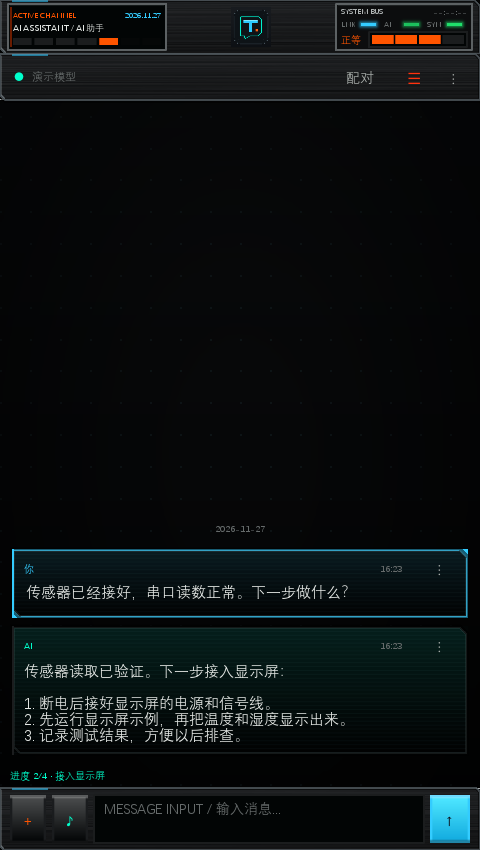
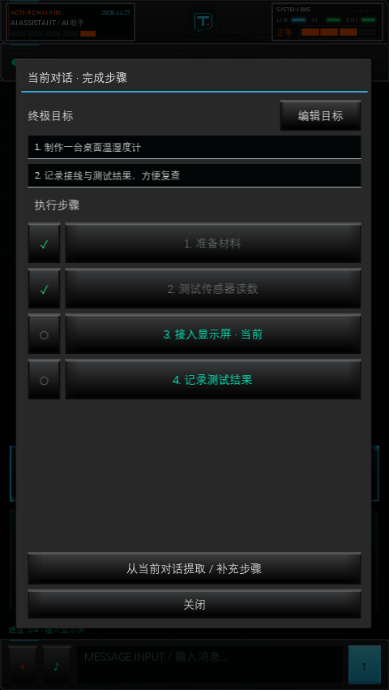

# TalkApp 1.0.0 基础操作

## 安装并配置模型

1. 在 [GitHub Releases](https://github.com/SkavenMiqi/three-cobblers/releases/tag/v1.0.0) 下载 `talkapp-1.0.0-arm64-v8a-debug.apk`，适用于 ARM64、Android 8.0 及以上。安卓若提示安装来源权限，可针对用于打开 APK 的浏览器或文件管理器授权。
2. 打开「⋮ → 设置与数据 → 模型接口与外观」，填写 OpenAI 兼容服务商的接口地址、自己的 API Key 和模型 ID，保存。图片、语音和进度工具分别需要模型和服务商支持相应功能。
3. 回到首页，在底部输入框发送消息。API 请求由你配置的服务商计费；「设置与数据 → 用量统计」只显示当天累计 tokens 和有记录时的估算费用。

## 聊天与历史

- 点「＋」附加图片或文件；按住音符按钮可录音，松开发送。消息右边的「⋮」可复制消息、代码或引用内容。
- 右上角滑杆从左到右是「精简」「适度」「正等」「详细」，按对话保存，从下一次回复生效。档位指导大致篇幅。
- 点顶部三横线打开历史记录和新建对话。长对话会保留原文，可通过「查找本对话」定位内容。

## 用 AI 整理项目进度

点首页底部的「进度」。最上方可编辑多条「终极目标」，下方是本对话的执行步骤。可以手动勾选，也可以直接告诉 AI：

- 「把准备材料、搭建原型加入进度。」
- 「我已经验证了原型，帮我确认进度并记录测试结果。」
- 「把第 5 步移到第 2 步，然后折叠已完成项。」

确认过的型号、接线和读数可以保存为短笔记，之后在同一对话分支按需检索。折叠和保存笔记会保留原记录。

## 可选：连接电脑 Harness

日常聊天可独立在手机上使用。需要电脑协作时，点手机首页「Harness」，让电脑和手机接入同一局域网。首次可让获得你授权的电脑助手读取手机里的部署清单，启动轻量后台，再由手机扫描终端上的配对二维码。附带后台使用 OpenCode V2；已有配对平时只需局域网重连，无需无线调试。启用后，当前普通对话的近期文字会同步到已配对的电脑。

## 界面截图

以下为使用演示数据的应用界面截图。

| 对话首页 | 项目进度 |
| --- | --- |
|  |  |
